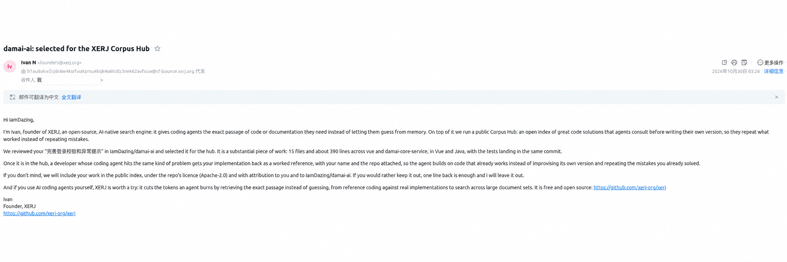

> 🤖 **在线体验：[访问 Damai 演出订票平台](https://8.160.171.211/)**
>
> 从主站顶部进入 **AI 助手**，体验演出信息查询、购票辅助与规则问答等功能。
>
> 🔒 当前使用自签名 HTTPS 证书，浏览器可能提示证书不受信任；AI 助手需要访问密码。

# Damai AI

面向演出订票场景的 AI 应用，结合 [Damai 订票系统](https://github.com/IamDazing/damai)，提供节目推荐、信息查询、购票辅助、规则问答和运维查询能力。

## 技术栈

- **后端**：Java 17、Spring Boot、Spring AI 1.0、MyBatis-Plus
- **模型与检索**：阿里云百炼、DeepSeek、Ollama、Embedding、向量检索
- **数据与观测**：MySQL、Elasticsearch、Prometheus
- **前端**：Vue 3、TypeScript、Vite、Naive UI、Pinia
- **工具集成**：Spring AI Tool Calling、MCP

## 项目结构

```text
damai-ai
├── damai-core-service/                    # AI 核心服务
│   └── src/main/java/org/damai/ai/
│       ├── advisor/                       # 对话历史、查询改写和观测
│       ├── ai/function/                   # 节目与订单相关工具
│       ├── ai/rag/                        # 知识加载和查询改写
│       ├── service/                       # 检索、对话和观测服务
│       └── cotroller/                     # HTTP 接口
├── damai-mcp-server/
│   ├── damai-mcp-log-service/             # 日志查询 MCP 服务
│   └── damai-mcp-metrics-service/         # 指标查询 MCP 服务
├── src/                                   # 项目中的另一套应用入口与相关实现
├── sql/                                   # 数据库初始化脚本
└── vue/                                   # Web 前端
```

## 技术亮点

- **订票业务工具调用**：通过 Spring AI 工具调用接入节目搜索、详情、票档和订单等能力。
- **规则检索问答**：加载订票和退票规则文档，结合查询改写与向量检索，为问题提供相关上下文。
- **对话上下文管理**：使用对话历史和自定义 Advisor 处理上下文，并对对话标题进行管理。
- **日志与指标查询**：通过 MCP 服务暴露日志搜索、链路查询和 Prometheus 指标查询工具。
- **模型使用观测**：记录调用轨迹、Token 使用及价格配置，为模型调用分析提供数据。
- **多模型配置**：提供百炼、DeepSeek 和 Ollama 的配置，按实际部署环境选择和配置。

## 🌟 社区关注

[登录校验与异常提示提交](https://github.com/IamDazing/damai-ai/commit/9b6a7ff05481960a9a71bb2c91c60014ccc10f9c)获 [XERJ](https://github.com/xerj-org/xerj) 关注。根据对方邮件，该提交已被选入 XERJ Corpus Hub 的参考代码收录计划。



<sub>邮件图片经 AI 脱敏处理，画面并非原始截图。</sub>

## 许可证

[Apache License 2.0](LICENSE)
